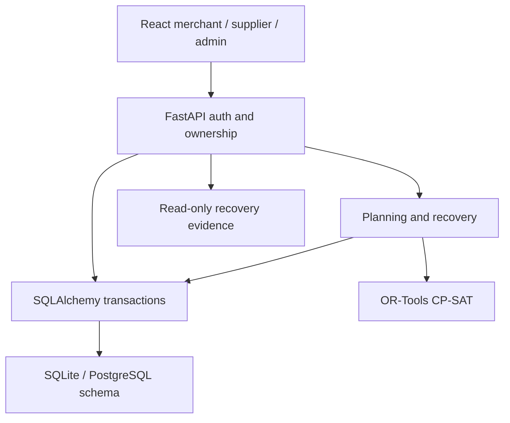

# Implemented architecture

One modular application, no agent orchestration, event broker or microservice split. Identity owns roles/profiles; catalog owns canonical products and offers; orders own policy snapshots and plan history; allocations reference their exact inventory offer. Supplier events append to history. Evidence derives from selected plans; it is not a separate counter that can drift.

Create -> review low-confidence basket -> compare three plans -> merchant approval -> supplier confirmation -> atomic available-stock decrement -> partial/reject event -> copy commitments into a new selected plan -> optimize outstanding quantities -> await replacement confirmations -> dispatch/deliver -> invoice/receipt comparison. Plan selection cannot overwrite a previously approved order. API uses `/plan`, not the illustrative PDF `/optimize` name.

## Correctness and assumptions
- CP-SAT uses integer pack counts and paise. First minimize shortfall, then optimize profile cost if first-stage optimality is proven. Time-limited feasible results are not claimed globally optimal.
- Landed budget includes product and one estimated delivery charge per distinct supplier. Recovery subtracts carried spend, reuses existing delivery charges, caps the union of suppliers, and retains the initial eligible price ceiling.
- Pack rounding may oversupply demand by a pack; this is visible in quantities, under budget and stock constraints. Partial confirmation can be loose units from a pack.
- Offers older than 24h or marked stale are excluded. This policy is an assumption, not field-calibrated freshness. Quotes reserve nothing. Confirmation conditionally decrements available stock; failed conditions roll back.
- SQLite uses BEGIN IMMEDIATE for writes and order reads that can expire commitments. PostgreSQL has a coarse transaction advisory lock for those requests (not execution-verified here). This intentionally limits write concurrency and needs replacement with tested per-order/per-offer locking for scale.
- Capacity is checked per basket, in kg for kg products only. Litre/piece mass and cross-order/day transport capacity are not modeled; no physical fleet-capacity guarantee. No deadline constraint or live route optimization is claimed.
- Supplier shortfall after confirmation does not release allegedly unavailable stock. Suppliers must reconcile available stock explicitly; cancellation/release automation is absent.
- Confirmation retries return 409 without double decrement; dispatch is deduplicated. Durable client request keys and exactly-once external effects are not implemented.
- Recovery is synchronous in the request transaction; solver has a 5s limit per stage. Lazy expiry runs on order reads, not a background scheduler. Long transactions are a known trade-off.
- Demo payments are simulated. Live/sandbox initiation and callback endpoints are disabled until provider signature and reconciliation tests exist. External requests are never needed for the demo.

## Security / observability
Ownership checked server-side; no public admin registration; local JWT only in demo; Supabase issuer/audience validation; CORS origins configured; numeric validation; default IP rate limit 200/min; no secrets distributed. Demo JWT secret/default credentials must never be used on a public service. Session token remains in localStorage: production CSP/session threat review is outstanding. Audit history is application-append-only, not tamper-proof against DB admins. Logs plus health endpoint and test/benchmark JSON are implemented; metrics/tracing, backups, restore drills, retention/deletion and alerting are operational roadmap.

## Future scale, not current claims
Move to partitioned PostgreSQL with indexed bounded queries, per-offer reservations with expiries, durable outbox and idempotent workers; region-local supplier graphs and constrained optimization queues; paginate order histories; add SLO/error metrics and backups. Avoid a cache until measured reads justify it. ONDC/POS integrations require permission, contracts and operational verification. No production deployment performed.
